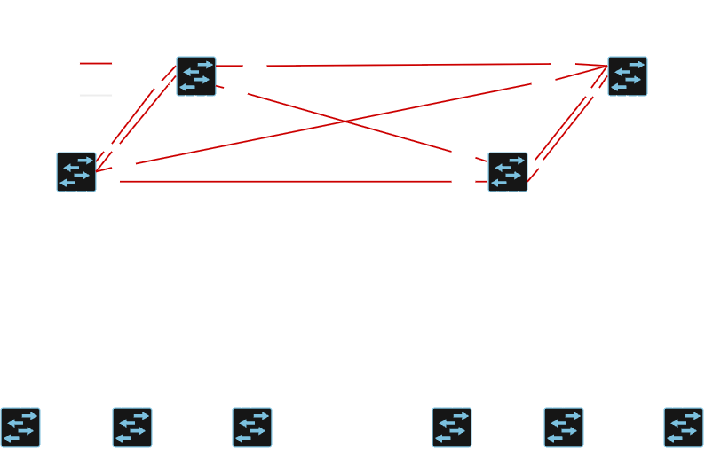

# l2-collapsed-core-campus-802.1x-lan
Kahden rakennuksen L2 Collapsed-Core kampusverkon toteutus, jossa hyödynnetään porttikohtaista 802.1X-autentikaatiota, dynaamista VLAN-määritystä ja OSPF Unnumbered runkoverkkoa. Toteutin tämän projekin Kaakkois-Suomen ammattikorkeakoulun VirtualLab-alustalla ja kytkiminä käytin Ciscon vIOSl2-kuvia.

## Verkon topologia

## VLAN-segmentointi ja IPv4-osoitteet

Verkko muodostuu kahdesta rakennuksesta (Rakennus 1, Rakennus 2). Yrityksen sisäinen IPv4-osoitteisto on suunniteltu siten, että pohjana käytettiin IPv4 aluetta: `172.16.0.0/16`. Rakennukselle 1 annettiin IPv4 osoitealue: `172.16.1.0/24` ja Rakennukselle 2: `172.16.2.0/24`. Rakennuskohtaiset verkot on jaettu pienempiin osiin siten, että jokaiselle VLAN:lle on oma `/26` aliverkko. Käytännössä tämän kokoisten aliverkkojen kanssa IPv4 osoitteet loppuisivat nopeasti kesken, mutta ne sopivat laboratorioympäristöön.

- **VLAN 10 (STAFF):** `172.16.X.0/26`
- **VLAN 20 (GUEST):** `172.16.X.64/26`
- **VLAN 30 (MANAGEMENT)**: `172.16.X.128/26`
- **VLAN 40 (SERVICES)**: `172.16.X.192/26`
- **VLAN 99 (UNUSED)**: Ei IPv4 osoitealuetta. Käytetään Trunk-linkkien native VLANina estämään VLAN Hopping -hyökkäykset VLAN 1:stä.
- **VLAN 999 (UNAUTH)**: Ei IPv4 osoitealuetta. Käytetään 802.1X-porttien oletus VLANina ja karanteeni VLANina, mikäli päätelaitteen autentikointi epäonnistuu.

## Vikasietoisuus, kaistanleveys ja EtherChannel

Vikasietoisuuden ja kaistanleveyden parantamiseksi, Access- ja Distribution-tason kytkimen ovat yhdistetty toisiinsa L2 **EtherChannel**-liitännällä. Jokaiseen loogiseen EtherChannel-liitäntään liitettiin kaksi Etherent-kaapelia. EtherChannel-liitännän muodostamiseen käytettiin **LACP**:tä.

## Spanning Tree Protocol

Kytkimillä käytetään Ciscon **Rapid PVST+** -protokollaa. Rakennusten sisäiseen verkkoon ei muodostu L2-silmukoita, koska Distribution-kytkimet on yhdistetty toisiinsa L3-porteilla. Tästä huolimatta **Root Bridge** -roolit on jaettu siten, että rakennusten sisällä kumpikin Distribution-kytkin on kahden VLANin **Root Bridge**.
